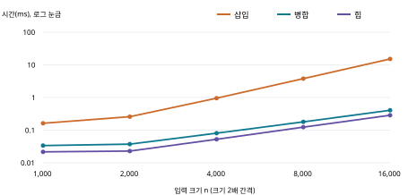

# 정렬 비교 실험
삽입 · 병합 · 힙 정렬

고급알고리즘 | 과제 1 Compare Sorting | 2026-09-30

이름: 최재혁    학번: 2026193137

GitHub 저장소: https://github.com/JH0097/hw1-2026193137-

## 1. 비교 목적과 선정 이유

수업에서 배운 목록의 삽입 정렬과 병합 정렬, 그 목록에 없는 힙 정렬을 비교한다. 입력의 크기와 배열 상태에 따라 실행 시간·키 비교·원소 이동이 어떻게 달라지는지 확인하고, 안정성과 추가 공간까지 함께 평가한다. 힙 정렬은 과제에서 지정한 Wikipedia 비교표에서 선택했다. [1]

삽입 정렬은 정렬된 앞부분에 새 원소를 삽입한다. 병합 정렬은 배열을 반으로 나누어 정렬한 뒤 합친다. 힙 정렬은 최대 힙의 루트에 최댓값을 모아 배열 뒤에서부터 위치를 확정한다. 세 접근을 통해 입력 적응성, 최악 시간 보장, 공간 절약의 차이를 관찰할 수 있다.

## 2. 구현 기준 이론 비교

| 알고리즘 | 최선 | 평균 / 최악 | 추가 공간 | 안정성 |
| --- | --- | --- | --- | --- |
| 삽입 | O(n) | O(n²) / O(n²) | O(1) | 안정 |
| 병합 | O(n log n) | O(n log n) / 동일 | O(n) | 안정 |
| 힙 | O(n)* | O(n log n) / 동일 | O(1) | 불안정 |

* 힙 정렬의 최선 O(n)은 중복을 허용하며 모든 키가 같을 때 조기 종료하는 본 구현 기준이다. 서로 다른 키를 전제로 한 통상적 힙 정렬 분석과 구분한다. 병합은 이미 정렬된 구간을 건너뛰는 최적화를 넣지 않았다. 추가 공간은 입력 배열을 제외한 점근적 공간이다. [2]

## 3. 코드에서 고정한 선택

원소는 key와 tag를 갖는 C의 Record 구조체다. key만 비교하고 tag에는 입력 위치를 기록해 안정성을 검사한다. 삽입은 더 큰 원소만 밀며, 병합은 동점에서 왼쪽을 먼저 선택한다. 힙은 큰 자식과 교환하는 반복형 siftDown을 사용한다. 병합의 보조 배열은 한 번 할당하며 정렬 시간에 malloc/free 비용을 포함한다. 시간 측정용과 연산 계측용을 같은 소스에서 각각 컴파일했다.

코드·검증·실험·보고서 작성에 AI의 도움을 받았다. 수치는 제공된 코드를 실제 실행한 결과이며, AI 학습 자료는 6쪽과 report/AI_LEARNING.md에 첨부했다. AI의 작성·실행 보조 범위를 밝혀 결과의 생성 과정을 명시했다.

---

# 힙 정렬의 원리와 검증

## 4. 최대 힙을 배열에 저장하기

최대 힙은 부모의 키가 자식의 키 이상인 완전 이진 트리다. 0부터 시작하는 배열에서 i번 노드의 왼쪽·오른쪽 자식은 2i+1, 2i+2이다. 루트 a[0]가 최댓값이지만, 형제끼리 또는 서로 다른 하위 트리끼리 정렬되어 있을 필요는 없다. 힙은 완전히 정렬된 배열과 다르다. [2]

## 5. 두 단계의 정렬 과정

(1) 힙 구성: 마지막 부모 n/2-1에서 루트까지 거꾸로 방문하며 siftDown을 수행한다. 자식 쪽 부분 트리가 이미 힙인 상태에서 부모를 내려 힙 조건을 맞춘다.
(2) 최댓값 추출: 루트와 현재 힙의 마지막 원소를 교환하고, 힙 크기를 하나 줄인다. 새 루트를 내려 힙을 복구한다. 이 과정을 반복하면 오른쪽 정렬 영역이 한 칸씩 늘어난다.

| 단계 | 배열 상태 | 확인할 성질 |
| --- | --- | --- |
| 입력 | [4, 1, 3, 2] | 아직 힙이 아님 |
| 힙 구성 | [4, 2, 3, 1] | 모든 부모가 자식 이상 |
| 4 확정 | [3, 2, 1 \| 4] | 오른쪽 4는 최종 위치 |
| 3 확정 | [2, 1 \| 3, 4] | 왼쪽만 다시 힙으로 복구 |
| 2 확정 | [1 \| 2, 3, 4] | 오름차순 정렬 완료 |

세로선 오른쪽은 확정 영역이다. 반복 직전에는 왼쪽이 최대 힙이고, 오른쪽은 정렬되어 있으며 왼쪽의 모든 원소 이상이다. 루트인 최댓값을 경계로 옮기므로 이 불변식이 유지된다. 힙 크기가 1이 되면 전체가 정렬된다.

## 6. 복잡도와 안정성

힙 구성의 각 노드가 모두 log n만큼 내려가는 것은 아니다. 높이 h인 노드는 대략 n/2^(h+1)개이고, 각 노드의 비용은 O(h)이다. 따라서 총비용은 n × sum(h/2^(h+1))의 상수배 이내이며, 급수가 수렴하므로 O(n)이다. 이후 최대 n-1번의 추출에서 각각 O(log n)이 걸려 최악 시간은 O(n log n)이 된다.

본 siftDown은 재귀 없이 인덱스와 임시 원소만 사용하여 추가 공간 O(1)이다. 다만 멀리 떨어진 원소를 교환하므로 안정적이지 않다. 실제 검사에서 [2A, 2B, 1C]는 [1C, 2B, 2A]가 되었다. 키는 정렬되었지만 같은 키 2의 순서는 바뀌었다. 작은 반례 하나만으로 안정 정렬이 아님을 확인할 수 있다.

---

# 실험 설계와 정확성 검사

## 7. 재현 가능한 실행 조건

실행 시각: 2026-09-30 21:19:51 (KST)
환경: Darwin 25.6.0 / arm64, C17
컴파일러: clang version 20.1.2
옵션: -Isrc -std=c17 -O2 -Wall -Wextra -Wpedantic
타이머: clock_gettime(CLOCK_MONOTONIC), 단조 증가 시계
크기: 1,000, 2,000, 4,000, 8,000, 16,000; 조건별 7회; 기본 시드 20260930.

| 입력 | 만드는 방법 |
| --- | --- |
| 무작위 | 0..n-1의 순열을 고정 시드로 섞음 |
| 정렬됨 | 0..n-1의 오름차순 |
| 역순 | n-1..0의 내림차순 |
| 중복 많음 | 각 키를 0..15에서 난수로 선택 |
| 거의 정렬됨 | 오름차순에서 무작위 인접 교환을 n/100회 수행 |

난수기는 xorshift32이며 범위 선택은 거절 샘플링, 순열은 Fisher-Yates 방식이다. 시드 = 20260930 + n + 97×입력종류번호 + 1009×반복번호. 종류번호는 표 순서대로 0..4, 반복번호는 0..6이다. 같은 조건·반복에서 세 알고리즘에 동일한 입력의 복사본을 제공한다. 거의 정렬됨은 인접 교환만 허용했으므로 멀리 떨어진 소수 원소를 섞는 상황과는 다르다.

## 8. 측정의 공정성과 한계

입력 생성·복사·검증은 시간 구간에서 제외한다. 조건마다 알고리즘별 1회 예열한 뒤 호출 순서를 순환한다. 매 측정에서 미리 복사한 배열 16개를 정렬하고 총 경과 시간을 16으로 나눈다. 5개 크기 × 5개 형태 × 3개 알고리즘 × 7회 = 525개 배치, 총 8,400회 정렬이다. 같은 입력으로 별도 525회 실행해 연산 수를 센다.

시간 실행에서는 전처리기로 카운터 코드를 제거한다. 계측 실행은 -DCOUNT_STATS를 추가한다. 배치 루프·함수 호출 비용은 시간에 포함된다. 결과는 이 C 구현·컴파일러·환경의 성능이다. 반복마다 입력도 바뀌므로 최소~최대에는 입력 차이와 시스템 잡음이 함께 들어간다. 7회 측정값으로 통계적 유의성을 주장하지 않는다.

## 9. 정확성 및 안정성 검사

C 테스트를 계측 유무 두 빌드에서 실행했다. 각각 길이 0..7의 모든 {-1,0,1} 배열 3,280개, 길이 0..257의 5개 입력 형태 1,290개, INT_MIN·INT_MAX 사례 1개를 세 정렬로 검사했다. 총 4,571개 입력 사례의 키 결과를 표준 qsort와 대조했다. 빈 배열·단일 원소·중복·홀수 크기·분할 경계를 포함하며 두 빌드에서 합계 73,159개 검사를 통과했고, UBSan 빌드도 36,583개 검사를 통과했다.

tag의 중복·누락과 key 변조도 검사했다. 안정 정렬은 같은 키의 tag 순서를 보존해야 한다. 8,400회 시간 실행과 525회 계측 실행이 정렬·원소 보존 검사를 통과했다. 배치 내 결과와 두 빌드의 결과 해시·안정성 판정도 모두 일치했다. 고유 키만 있는 입력의 안정성 통과는 의미가 약하므로 중복 입력과 반례를 별도로 사용했다.

---

# 실행 시간 비교

## 10. 크기가 커질 때의 변화

무작위 입력을 8,000개에서 16,000개로 늘리면 중앙값은 삽입 4.00배, 병합 2.26배, 힙 2.32배가 되었다. 삽입의 약 4배 증가는 이차적 증가와, 병합·힙의 약 2배 증가는 n log n 증가와 대체로 일치한다. 유한한 실험만으로 복잡도를 증명하는 것은 아니다.

## 11. 입력 형태별 시간 (n=16,000)

| 입력 | 삽입 (ms) | 병합 (ms) | 힙 (ms) |
| --- | --- | --- | --- |
| 무작위 | 15.148 | 0.406 | 0.286 |
| 정렬됨 | 0.005 | 0.228 | 0.227 |
| 역순 | 29.922 | 0.237 | 0.219 |
| 중복 많음 | 14.198 | 0.400 | 0.242 |
| 거의 정렬됨 | 0.006 | 0.229 | 0.233 |

표는 배치당 정렬 1회 평균 시간을 구한 뒤 7개 배치에서 얻은 중앙값. 원본과 최소·최대 시간은 results/raw.csv 및 summary.csv에 보존했다.

무작위 16,000개에서는 힙 0.286 ms, 병합 0.406 ms, 삽입 15.148 ms였다. 힙의 비교·이동 횟수가 병합보다 많아도 실행 시간은 더 짧았다. 소스 수준 연산 수만으로 시간 순위를 단정할 수 없다. 반면 정렬됨 입력은 삽입 0.005 ms로 가장 빨랐고, 거의 정렬됨에서도 같은 경향이었다.

무작위 조건의 최소~최대(ms)는 삽입 14.996~15.259, 병합 0.403~0.419, 힙 0.276~0.291이다. 할당·재귀·메모리 접근·컴파일러 최적화가 시간 차이에 영향을 줄 수 있으나 각각의 기여는 분리 측정하지 않았다. 결과를 다른 구현에 일반화할 수 없다.

---

# 연산 수 · 공간 · 선택 기준

## 12. 비교와 이동 횟수 (n=16,000, 7회 중앙값)

| 입력 | 정렬 | 키 비교 | 원소 이동 |
| --- | --- | --- | --- |
| 무작위 | 삽입 | 64,095,558 | 64,111,569 |
| 무작위 | 병합 | 203,301 | 447,232 |
| 무작위 | 힙 | 397,620 | 627,708 |
| 정렬됨 | 삽입 | 15,999 | 31,998 |
| 정렬됨 | 병합 | 110,912 | 447,232 |
| 정렬됨 | 힙 | 410,921 | 661,140 |
| 역순 | 삽입 | 127,992,000 | 128,023,998 |
| 역순 | 병합 | 112,704 | 447,232 |
| 역순 | 힙 | 384,387 | 593,628 |
| 중복 많음 | 삽입 | 60,046,255 | 60,062,257 |
| 중복 많음 | 병합 | 199,350 | 447,232 |
| 중복 많음 | 힙 | 379,642 | 591,549 |
| 거의 정렬됨 | 삽입 | 16,157 | 32,156 |
| 거의 정렬됨 | 병합 | 110,996 | 447,232 |
| 거의 정렬됨 | 힙 | 410,892 | 660,462 |

비교는 두 key를 견준 횟수만 센다. 이동은 Record 원소를 명시적으로 대입한 횟수이며 임시 저장도 포함한다. 교환은 3회다. 반복 인덱스·함수 인자 전달·측정 전 입력 복사는 제외한다. 이 값은 소스 수준의 연산 수이며 최적화된 기계어 명령 수가 아니다. [3]

정렬된 입력의 삽입 비교 15,999회는 n-1과 같고, 역순 비교 127,992,000회는 n(n-1)/2와 같다. 삽입의 이동은 꺼내기와 다시 쓰기를 세므로 정렬된 입력에서도 2(n-1)회이다. 병합은 입력 형태와 관계없이 같은 분할 구조를 거쳐 이동 횟수가 같았다.

## 13. 공간과 안정성

병합은 n=16,000일 때 보조 배열 128,000바이트(Record 8바이트 × n)와 O(log n) 재귀 스택을 사용한다. 삽입·힙은 상수 개의 작업 원소를 사용해 O(1) 추가 공간이다. 이 비교는 소스 코드의 할당 구조를 기준으로 하며 프로세스 전체 메모리 사용량의 실측값이 아니다. 중복 입력에서 삽입·병합은 7/7회, 힙은 0/7회 같은 키의 순서를 보존했다.

## 14. 결론과 적용 범위

정렬되었거나 인접한 소수의 순서만 바뀐 자료에는 삽입 정렬이 유리했다. 무작위 입력의 시간은 본 힙 구현이 가장 짧았다. 안정성이 필요하면 병합이 적합하며, 추가 배열을 피하면서 최악 O(n log n)을 보장하려면 힙이 대안이다. 성능 선택에는 실행 시간뿐 아니라 입력 특성·안정성·공간 제약이 함께 필요하다.

이번 결과는 단일 환경, 최대 16,000개, 다섯 입력 형태의 범위에 한정된다. 더 큰 자료, 다른 거의 정렬 패턴, 다른 컴파일러, 실제 메모리 사용량을 추가로 비교하면 결론의 적용 범위를 더 확인할 수 있다.

---

# AI 학습 내용과 참고 자료

## 15. AI를 통해 학습한 힙 정렬

아래는 OpenAI Codex가 작성한 학습용 문답이다. 실제 학생-AI 대화 원문이나 학생이 이미 학습을 완료했다는 기록은 아니다. 원리·추적 예제·복잡도 설명의 전체 학습 자료는 report/AI_LEARNING.md에 함께 첨부했다.

## Q1. 왜 작은 자식이 아니라 큰 자식과 교환하는가?

부모가 작을 때 작은 자식과 바꾸면 더 큰 자식이 여전히 부모보다 커서 최대 힙 조건이 깨진다. 큰 자식을 올려야 현재 위치를 고치고 문제를 한 단계 아래로 옮길 수 있다.

## Q2. 힙을 만드는 데 왜 O(n log n)이 아니라 O(n)인가?

높이가 낮은 노드가 훨씬 많기 때문이다. 잎은 내릴 필요가 없고, 그 위 노드는 많아야 한 층 내려간다. 높이별 노드 수와 비용을 곱해 합하면 O(n)으로 제한된다.

## Q3. 힙 정렬은 항상 n log n만큼 걸리는가?

최악 상한과 모든 입력의 실행량을 구분해야 한다. 본 구현은 모든 키가 같으면 siftDown을 즉시 멈춰 선형 시간이 가능하다. 반면 고유 키를 갖는 정렬된 배열이라고 삽입 정렬처럼 한 번 훑고 끝나지는 않는다.

## Q4. 안정성을 태그까지 비교해서 확인하면 되는가?

아니다. 태그까지 정렬 기준에 넣으면 키만 같은 원소를 비교하는 문제가 달라진다. key만 비교하고, 정렬 후 같은 key의 tag가 입력 순서대로 남았는지를 검사해야 한다.

확인한 핵심: (1) 부모·자식 관계는 인덱스로 표현한다. (2) 확정 영역은 힙 복구에서 제외한다. (3) O(n log n) 시간 보장과 안정성은 별개다. 코드 검사와 불안정성 반례로 AI 설명의 핵심을 확인했다.

## 16. 참고 자료 및 출처 (확인일 2026-09-30)

[[1] Wikipedia, Sorting algorithm - Comparison of algorithms](https://en.wikipedia.org/wiki/Sorting_algorithm#Comparison_of_algorithms)

[[2] Sedgewick & Wayne, Algorithms, 4th ed., §2.4 Priority Queues](https://algs4.cs.princeton.edu/24pq/)

[[3] 강의 기본 정렬: 비교·이동 계수와 안정성 설명](https://github.com/lec-algorithm/lecture/blob/main/site/src/content/courses/ko/topic-02-basic-sorting.mdx)

[[4] 수업 병합 정렬 구현: 동점 처리와 병합 구조 참고](https://github.com/lec-algorithm/algorithm-code/blob/main/src/topic-03-divide-conquer/01_merge_sort/mergeSort.c)

[[5] 과제 샘플: 코드·알고리즘·실험 구성 참고](https://github.com/lec-algorithm/hw1-sample-2026/blob/main/report/REPORT.md)

[[6] 실습 환경 템플릿: 저장소 생성 및 실행 안내](https://github.com/lec-algorithm/algorithm-env)

제공된 algorithm-viz 저장소는 접근을 시도했지만 내용을 확인하지 못하여 분석 근거로 사용하지 않았다. 보고서의 수치 출처는 이 제출 코드가 생성한 results/ 파일이다. 분석은 본 구현과 측정 결과를 기준으로 작성했다.

---
